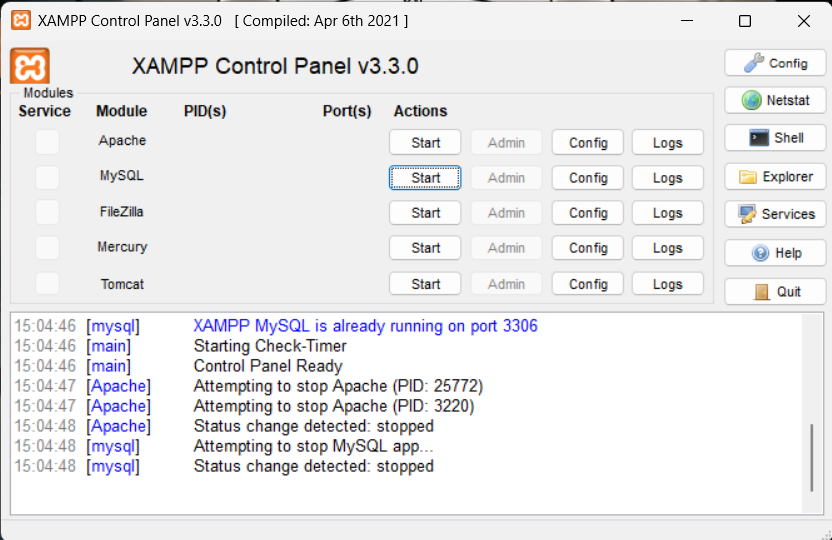
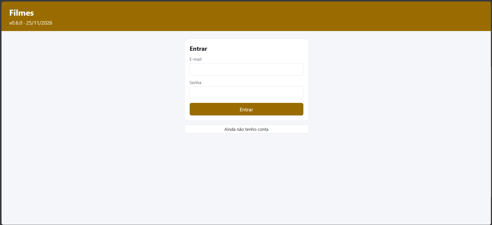
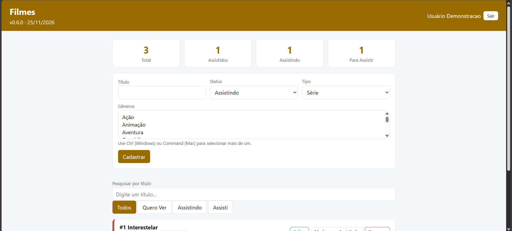
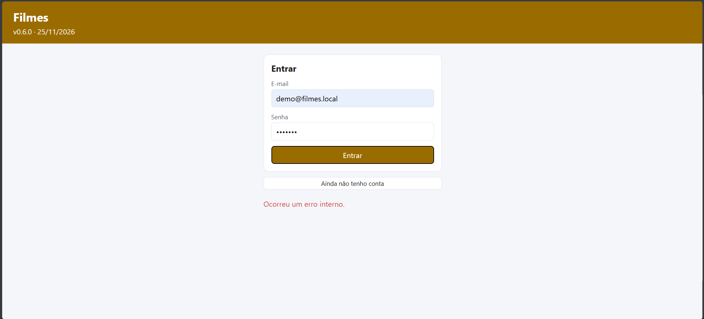
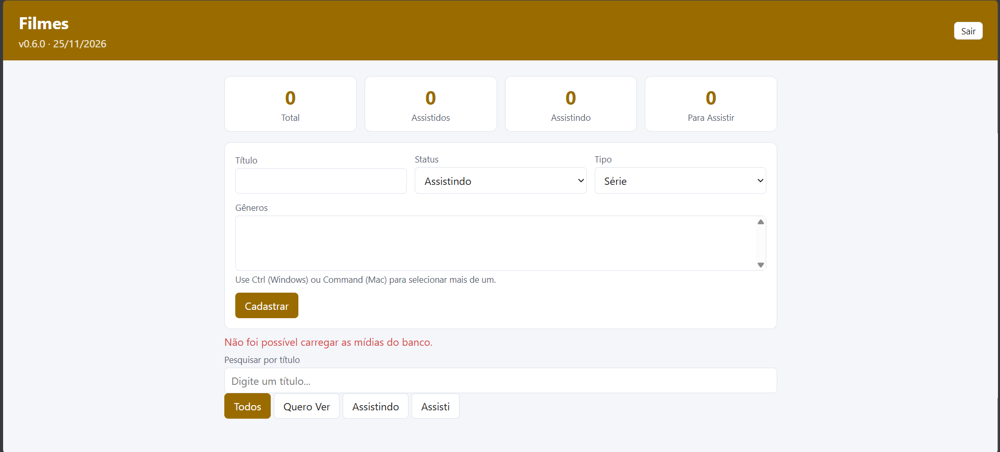

# Catálogo de filmes e séries

Aplicação TypeScript com interface Vite, API Express e MySQL.

## Estrutura

- `index.html`: tela de login e catálogo.
- `src/`: tipos, serviços e integração da página com a API.
- `api/src/`: API, autenticação JWT e acesso ao MySQL.
- `css/filmes.css`: estilos da interface.
- `docs/SQL.md`: modelo e exemplos do banco.
- `docs/catalogomidias.sql`: script completo para recriar o banco.
- `docs/imagens/`: imagens do DER e imagens para o README.

## Requisitos

- Node.js 20.19 ou superior
- npm
- MySQL/MariaDB do XAMPP

## Configuração do banco

1. Inicie o MySQL pelo XAMPP apertando em "Start" tanto na linha do Apache quanto na do MySQL
    

2. Execute o script completo:

```sh
mysql -u root -p < docs/catalogomidias.sql.sql
```

No Windows, execute o comando em um terminal aberto na raiz do projeto. O script cria o banco `catalogomidias`, as quatro tabelas, as restrições e os dados iniciais.

Conta de demonstração criada pelo script:

- E-mail: `demo@filmes.local`
- Senha: `demo123`

## Configuração da aplicação

Copie `.env.exemplo` para `.env` e ajuste as credenciais:

```env
DB_HOST=localhost
DB_PORT=3306
DB_USER=root
DB_PASSWORD=
DB_NAME=catalogomidias
API_PORT=3000
JWT_SEGREDO=gere-um-segredo-aleatorio-com-pelo-menos-32-caracteres
```

O arquivo `.env` não é versionado e contém configurações locais. Gere um segredo com:

```sh
node -e "console.log(require('node:crypto').randomBytes(32).toString('hex'))"
```

## Instalação e execução

```sh
npm install
npm run dev
```

A interface fica em uma porta localhost especifica, geralmente em `http://localhost:5173` (mas pode ser em outra então verfique a saída que aparece no terminal) e a API em `http://localhost:3000`.

## Verificação

```sh
npm run verificar
npm run build
```

Após isso o projeto vai rodar perfeitamente com todas as funcionalidades planejadas.

## Pagina Inicial



Após isso é só entrar com as credenciais teste que você verá:



Se a tela que aparecer para você for igual a esta, então seu projeot foi inicializado com exíto.
## Possíveis Erros pela falta do banco de dados (ou não inicalização)



