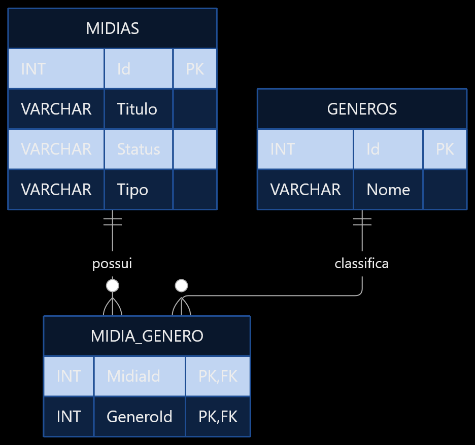

# Banco de dados do catálogo

O projeto usa MySQL/MariaDB do XAMPP. O banco existente deve se chamar `CatalogoMidias` e conter `Midias`, `Generos` e `MidiaGenero`. A API só consulta esses dados; não cria nem altera tabelas.

## Diagrama

| Campo | Tipo | Restrições |
|---|---|---|
| Midias.Id | INT | PK, AUTO_INCREMENT |
| Midias.Titulo | VARCHAR(200) | Obrigatório |
| Midias.Status | VARCHAR(20) | Quero ver, Assistindo ou Assisti |
| Midias.Tipo | VARCHAR(10) | Filme ou Série |
| Generos.Id | INT | PK, AUTO_INCREMENT |
| Generos.Nome | VARCHAR(50) | Obrigatório, único |
| MidiaGenero | relação N:N | PK composta e FKs para Midias e Generos |



## Script de criação para MySQL/MariaDB

Use este script somente para criar o banco e as tabelas caso ainda não existam. Ele não apaga nem migra tabelas já existentes.

```sql
CREATE DATABASE IF NOT EXISTS CatalogoMidias
  CHARACTER SET utf8mb4
  COLLATE utf8mb4_unicode_ci;

USE CatalogoMidias;

CREATE TABLE IF NOT EXISTS Midias (
    Id INT NOT NULL AUTO_INCREMENT PRIMARY KEY,
    Titulo VARCHAR(200) NOT NULL,
    Status VARCHAR(20) NOT NULL,
    Tipo VARCHAR(10) NOT NULL,
    CONSTRAINT chk_midias_status
        CHECK (Status IN ('Quero ver', 'Assistindo', 'Assisti')),
    CONSTRAINT chk_midias_tipo
        CHECK (Tipo IN ('Filme', 'Série'))
) ENGINE=InnoDB DEFAULT CHARSET=utf8mb4;

CREATE TABLE IF NOT EXISTS Generos (
    Id INT NOT NULL AUTO_INCREMENT PRIMARY KEY,
    Nome VARCHAR(50) NOT NULL UNIQUE
) ENGINE=InnoDB DEFAULT CHARSET=utf8mb4;

CREATE TABLE IF NOT EXISTS MidiaGenero (
    MidiaId INT NOT NULL,
    GeneroId INT NOT NULL,
    PRIMARY KEY (MidiaId, GeneroId),
    CONSTRAINT fk_midiagenero_midia
        FOREIGN KEY (MidiaId) REFERENCES Midias(Id),
    CONSTRAINT fk_midiagenero_genero
        FOREIGN KEY (GeneroId) REFERENCES Generos(Id)
) ENGINE=InnoDB DEFAULT CHARSET=utf8mb4;

INSERT IGNORE INTO Generos (Nome) VALUES
('Ação'),
('Aventura'),
('Animação'),
('Comédia'),
('Drama'),
('Fantasia'),
('Ficção científica'),
('Mistério'),
('Romance'),
('Suspense'),
('Terror'),
('Documentário'),
('Musical'),
('Crime'),
('Histórico');
```

## Exemplos

```sql
INSERT INTO Midias (Titulo, Status, Tipo)
VALUES ('Interestelar', 'Quero ver', 'Filme');

INSERT INTO MidiaGenero (MidiaId, GeneroId)
VALUES (1, 6), (1, 7);
```

Consulta equivalente à usada pela API para listar mídias e gêneros:

```sql
SELECT
    M.Id,
    M.Titulo,
    M.Status,
    M.Tipo,
    GROUP_CONCAT(G.Nome ORDER BY G.Nome SEPARATOR ',') AS Generos
FROM Midias M
LEFT JOIN MidiaGenero MG ON MG.MidiaId = M.Id
LEFT JOIN Generos G ON G.Id = MG.GeneroId
GROUP BY M.Id, M.Titulo, M.Status, M.Tipo
ORDER BY M.Id;
```
