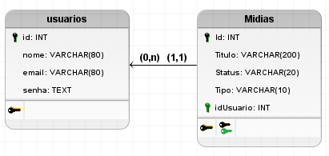
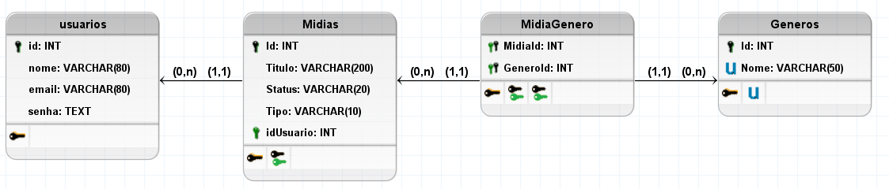

# Banco de dados do catalogo

O projeto usa o MySQL/MariaDB fornecido pelo XAMPP. A configuracao padrao, definida em `api/src/banco.ts`, conecta ao banco `catalogomidias` no endereco `localhost:3306`. O schema deve ser criado previamente no banco; a API nao executa criacoes ou alteracoes de tabelas.

O banco contem quatro tabelas:

| Tabela | Finalidade |
|---|---|
| `usuarios` | Contas cadastradas |
| `Midias` | Catalogo pessoal de cada usuario |
| `Generos` | Generos disponiveis para associacao |
| `MidiaGenero` | Relacao muitos para muitos entre midias e generos |

Cada `Midias.idUsuario` identifica o dono da midia. Dessa forma, as consultas de listagem, consulta, alteracao e exclusao filtram os registros pelo ID presente no JWT.

## Estrutura atual

### usuarios

| Campo | Tipo | Restricoes |
|---|---|---|
| `id` | INT | PRIMARY KEY, AUTO_INCREMENT |
| `nome` | VARCHAR(80) | NOT NULL |
| `email` | VARCHAR(80) | NOT NULL |
| `senha` | TEXT | NOT NULL; guarda o hash bcrypt |

O script `docs/banco.sql` cria uma restricao UNIQUE para `email` no banco. Ela impede duplicatas diretamente no banco; a API continua verificando e-mails antes do cadastro e trata `ER_DUP_ENTRY` como reforco.


### Midias

| Campo | Tipo | Restricoes |
|---|---|---|
| `Id` | INT | PRIMARY KEY, AUTO_INCREMENT |
| `Titulo` | VARCHAR(200) | NOT NULL |
| `Status` | VARCHAR(20) | NOT NULL; CHECK: `Quero ver`, `Assistindo` ou `Assisti` |
| `Tipo` | VARCHAR(10) | NOT NULL; CHECK: `Filme` ou `Série` |
| `idUsuario` | INT | NOT NULL, FK para `usuarios.id` |

A foreign key `conexcao_tabelas_midias_usuarios` usa `ON DELETE CASCADE`. Ao excluir um usuario, suas midias devem ser excluidas pelo banco.



### Generos

| Campo | Tipo | Restricoes |
|---|---|---|
| `Id` | INT | PRIMARY KEY, AUTO_INCREMENT |
| `Nome` | VARCHAR(50) | NOT NULL, UNIQUE |

### MidiaGenero

| Campo | Tipo | Restricoes |
|---|---|---|
| `MidiaId` | INT | PK composta, FK para `Midias.Id` |
| `GeneroId` | INT | PK composta, FK para `Generos.Id` |

## Diagrama


_(arquivo `diagrama-brModelo.brM3`)_

## Referencia de criacao

Este script representa a estrutura usada pelo projeto. Nao deve ser executado diretamente em um banco que ja possui as tabelas, pois o projeto nao cria nem atualiza o schema automaticamente.

```sql
CREATE DATABASE IF NOT EXISTS catalogomidias
  CHARACTER SET utf8mb4
  COLLATE utf8mb4_unicode_ci;

USE catalogomidias;

CREATE TABLE IF NOT EXISTS usuarios (
    id INT NOT NULL AUTO_INCREMENT,
    nome VARCHAR(80) NOT NULL,
    email VARCHAR(80) NOT NULL,
    senha TEXT NOT NULL,
    PRIMARY KEY (id),
    UNIQUE KEY uk_usuarios_email (email)
) ENGINE=InnoDB DEFAULT CHARSET=utf8mb4 COLLATE=utf8mb4_unicode_ci;

CREATE TABLE IF NOT EXISTS Midias (
    Id INT NOT NULL AUTO_INCREMENT,
    Titulo VARCHAR(200) NOT NULL,
    Status VARCHAR(20) NOT NULL,
    Tipo VARCHAR(10) NOT NULL,
    idUsuario INT NOT NULL,
    PRIMARY KEY (Id),
    CONSTRAINT chk_midias_status
        CHECK (Status IN ('Quero ver', 'Assistindo', 'Assisti')),
    CONSTRAINT chk_midias_tipo
        CHECK (Tipo IN ('Filme', 'Série')),
    CONSTRAINT conexcao_tabelas_midias_usuarios
        FOREIGN KEY (idUsuario) REFERENCES usuarios(id)
        ON DELETE CASCADE ON UPDATE NO ACTION
) ENGINE=InnoDB DEFAULT CHARSET=utf8mb4 COLLATE=utf8mb4_unicode_ci;

CREATE TABLE IF NOT EXISTS Generos (
    Id INT NOT NULL AUTO_INCREMENT,
    Nome VARCHAR(50) NOT NULL,
    PRIMARY KEY (Id),
    UNIQUE KEY uk_generos_nome (Nome)
) ENGINE=InnoDB DEFAULT CHARSET=utf8mb4 COLLATE=utf8mb4_unicode_ci;

CREATE TABLE IF NOT EXISTS MidiaGenero (
    MidiaId INT NOT NULL,
    GeneroId INT NOT NULL,
    PRIMARY KEY (MidiaId, GeneroId),
    CONSTRAINT fk_midiagenero_midia
        FOREIGN KEY (MidiaId) REFERENCES Midias(Id),
    CONSTRAINT fk_midiagenero_genero
        FOREIGN KEY (GeneroId) REFERENCES Generos(Id)
) ENGINE=InnoDB DEFAULT CHARSET=utf8mb4 COLLATE=utf8mb4_unicode_ci;
```

## Generos iniciais

O cadastro de uma nova midia aceita somente nomes presentes em `Generos`:

```sql
INSERT IGNORE INTO Generos (Nome) VALUES
('Ação'),
('Aventura'),
('Animação'),
('Comédia'),
('Drama'),
('Fantasia'),
('Ficção científica'),
('Mistério'),
('Romance'),
('Suspense'),
('Terror'),
('Documentário'),
('Musical'),
('Crime'),
('Histórico');
```

## Exemplos usados pela API

Cadastro de usuario com senha armazenada como hash bcrypt:

```sql
INSERT INTO usuarios (nome, email, senha)
VALUES ('Exemplo', 'exemplo@email.com', '<hash-bcrypt>');
```

Cadastro de uma midia para um usuario:

```sql
INSERT INTO Midias (Titulo, Status, Tipo, idUsuario)
VALUES ('Interestelar', 'Quero ver', 'Filme', 1);
```

Associacao da midia aos generos:

```sql
INSERT INTO MidiaGenero (MidiaId, GeneroId)
VALUES (1, 6), (1, 7);
```

Consulta equivalente a utilizada pela API para listar uma midia e seus generos:

```sql
SELECT
    M.Id AS id,
    M.Titulo AS titulo,
    M.Status AS status,
    M.Tipo AS tipo,
    GROUP_CONCAT(G.Nome ORDER BY G.Nome SEPARATOR ',') AS generos
FROM Midias M
LEFT JOIN MidiaGenero MG ON MG.MidiaId = M.Id
LEFT JOIN Generos G ON G.Id = MG.GeneroId
WHERE M.idUsuario = 1
GROUP BY M.Id, M.Titulo, M.Status, M.Tipo
ORDER BY M.Id;
```
