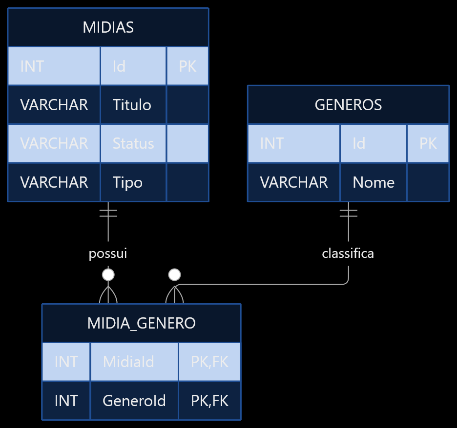

# SQL
## Notas
Não sou fã de database-first e inclusive acho um erro desenvolver desse jeito... Torna o debug hiper complexo e toda alteração um remendo não documentado... Mas por questões de simplicidade (e acadêmicas), esses são os comandos para a criação e administração do banco de dados com base no documento da aula.  
_**- Théo**_

## Diagrama
| Campo |     Tipo   | Restrições   |
|-------|------------|--------------|
|   Id  |     INT    | PK, Identity |
| Titulo|VARCHAR(200)| Obrigatório  |
| Status| VARCHAR(20)|Quero ver, Assistindo ou Assisti |
| Tipo  | VARCHAR(10)|Filme ou Série|
|Gêneros| Relação N:N|Um ou vários gêneros|




## Script Inicial
```sql
-- Criação do banco de dados
CREATE DATABASE CatalogoMidias;
GO

USE CatalogoMidias;
GO

-- Tabela principal
CREATE TABLE Midias (
    Id INT IDENTITY(1,1) PRIMARY KEY,
    Titulo VARCHAR(200) NOT NULL,

    Status VARCHAR(20) NOT NULL
        CHECK (Status IN ('Quero ver', 'Assistindo', 'Assisti')),

    Tipo VARCHAR(10) NOT NULL
        CHECK (Tipo IN ('Filme', 'Série'))
);
GO

-- Tabela de gêneros
CREATE TABLE Generos (
    Id INT IDENTITY(1,1) PRIMARY KEY,
    Nome VARCHAR(50) NOT NULL UNIQUE
);
GO

-- Relacionamento entre mídias e gêneros
CREATE TABLE MidiaGenero (
    MidiaId INT NOT NULL,
    GeneroId INT NOT NULL,

    PRIMARY KEY (MidiaId, GeneroId),

    FOREIGN KEY (MidiaId) REFERENCES Midias(Id),
    FOREIGN KEY (GeneroId) REFERENCES Generos(Id)
);
GO

-- Gêneros
INSERT INTO Generos (Nome) VALUES
('Ação'),
('Aventura'),
('Animação'),
('Comédia'),
('Drama'),
('Fantasia'),
('Ficção científica'),
('Mistério'),
('Romance'),
('Suspense'),
('Terror'),
('Documentário'),
('Musical'),
('Crime'),
('Histórico');
```

## Exemplos de uso
- Cadastro:
    ```sql
    INSERT INTO Midias (Titulo, Status, Tipo) VALUES ('Interestelar', 'Quero ver', 'Filme);
    ```
- Insert
    ```sql
    INSERT INTO MidiaGenero (MidiaId, GeneroId)
    VALUES
    (1, 6), -- Fantasia
    (1, 7); -- Ficção científica
    ```
- Consultar mídias com gêneros
    ```sql
    SELECT
        M.Id,
        M.Titulo,
        M.Status,
        M.Tipo,
        STRING_AGG(G.Nome, ', ') AS Generos
    FROM Midias M
    LEFT JOIN MidiaGenero MG ON MG.MidiaId = M.Id
    LEFT JOIN Generos G ON G.Id = MG.GeneroId
    GROUP BY M.Id, M.Titulo, M.Status, M.Tipo;
    ```
    Uma observação sobre essa consulta é sobre a redução de querys N+1, incorporando uma consulta que poderia ser feita em diversas queries em apenas uma, reduzindo consumo geral de processamento de banco de dados (caso em um ambiente de produção real)  
    **_(é um tópico muito interessante e recomendo que pesquisem caso tenham interesse)_**